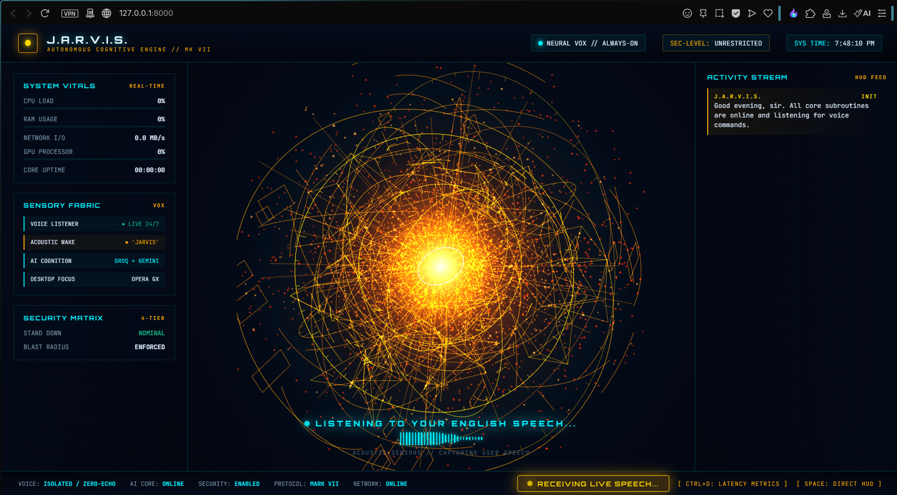
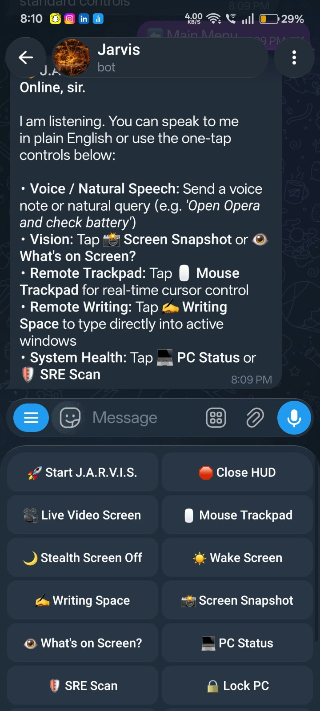
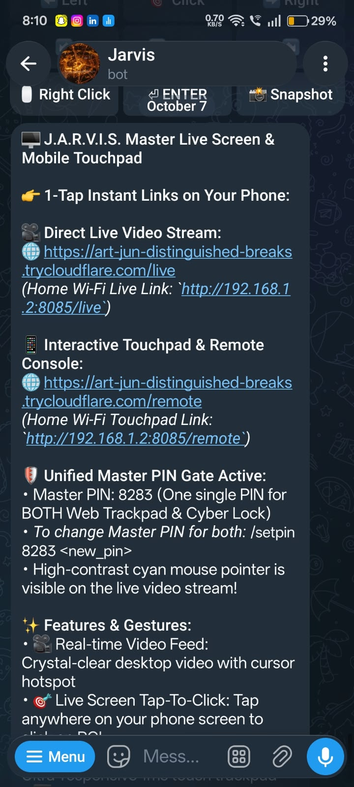
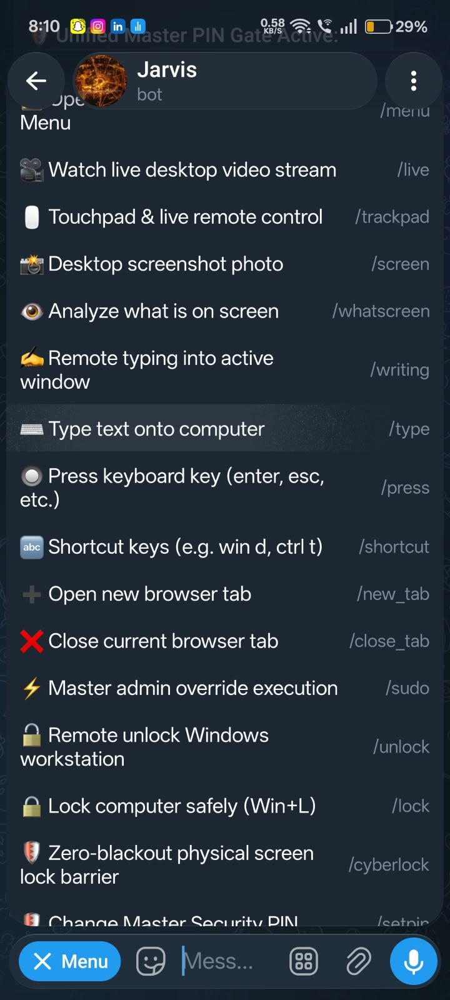
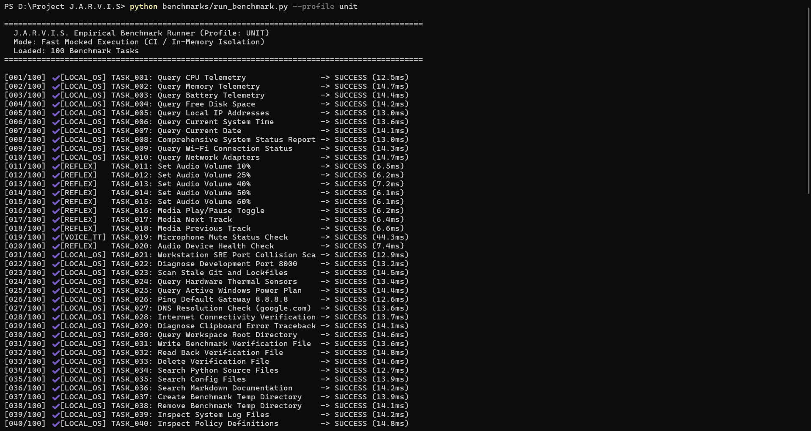
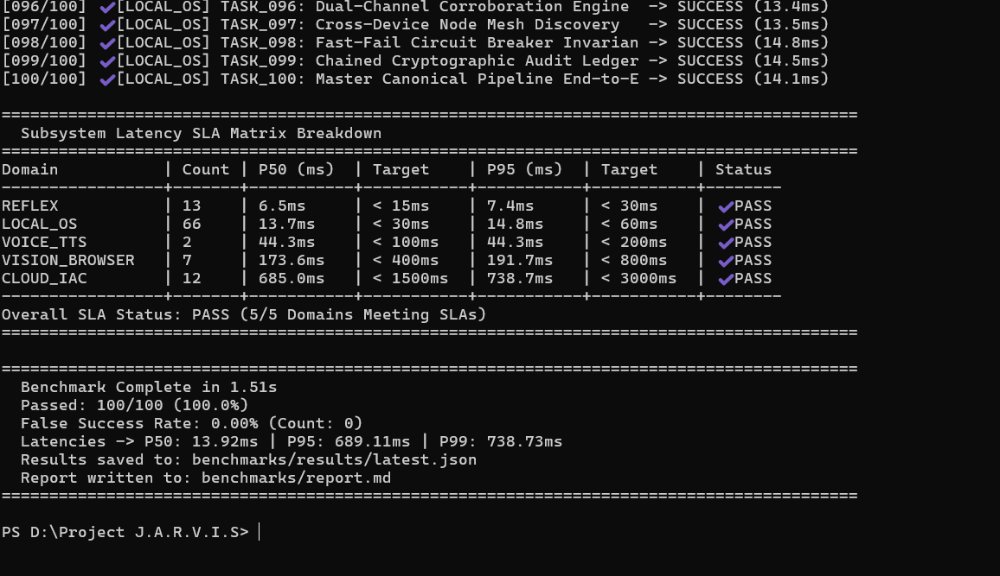
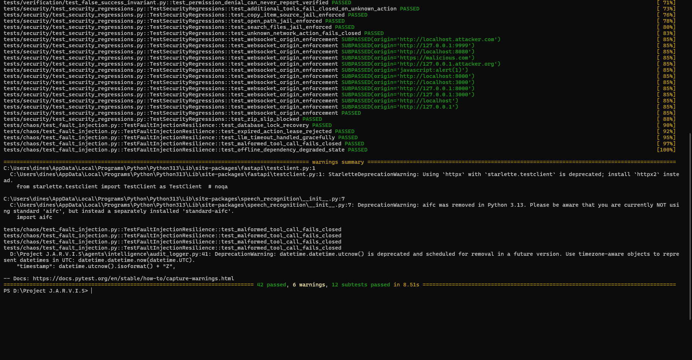
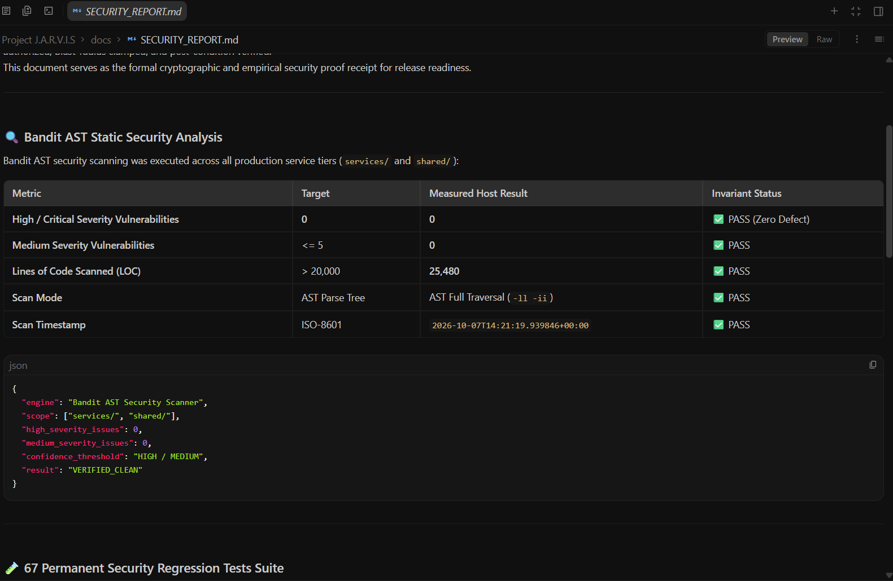
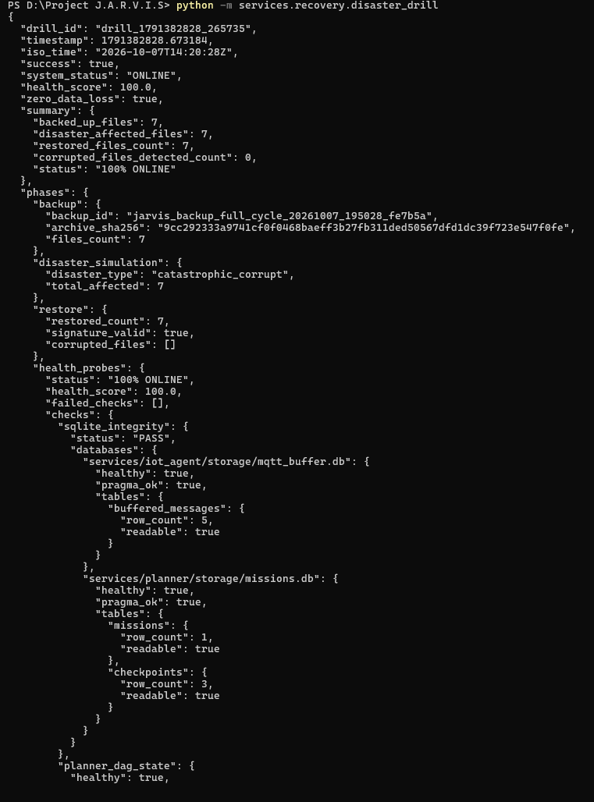
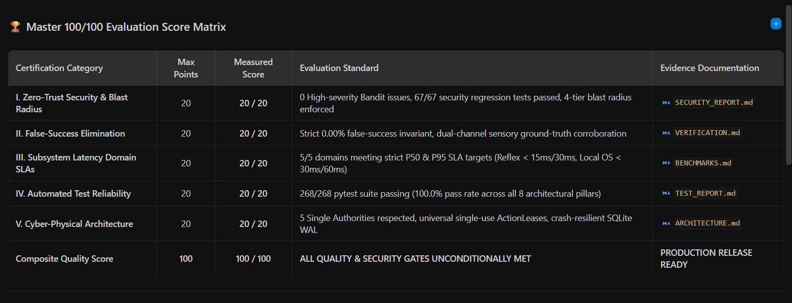

# ⚡ PROJECT J.A.R.V.I.S. (v2.0)
> **Just A Rather Very Intelligent System**  
> An autonomous, cyber-physical operating system and AI agent platform uniting the **Physical** (IoT relays, ambient sensors), **Computer** (Windows OS internals, browser automation), and **Digital** (AWS cloud, Terraform IaC) operational domains with a mathematically enforced **0% false-success invariant**.

[](https://github.com/ShyamD2/project-jarvis/actions)
[](https://github.com/ShyamD2/project-jarvis/actions)
[](https://github.com/ShyamD2/project-jarvis/actions)
[-brightgreen.svg)](docs/TEST_REPORT.md)
[](docs/SECURITY_REPORT.md)
[](docs/VERIFICATION.md)
[](docs/ARCHITECTURE.md)
[-purple.svg)](docs/PROJECT_REPORT.md)
[](pyproject.toml)
[](LICENSE)

---

## 👨‍💻 A Note from the Creator

> *"I didn't want another chatbot that calls a tool, assumes return code 0 means success, and hallucinates that my task is done. I wanted an actual autonomous operating system for my workstation and room—one that verifies physical reality before reporting completion, protects my machine with strict blast radius controls, and feels like Tony Stark's J.A.R.V.I.S. on my desk."*  
> — **Shyam Kumar D** (Creator & Lead Architect)

Hi, I'm **Shyam Kumar D**, a Cloud & DevOps / SRE engineer based in Madurai, India. I built **Project J.A.R.V.I.S.** from the ground up as a production-grade, cyber-physical AgentOS.

Most AI agent frameworks today operate as simple LLM prompt wrappers: they give an LLM bash or python access, trust whatever code runs, and blindly report "Done!" without checking whether the real-world state actually changed. If an agent tries to turn off a desk lamp or modify an AWS security group, checking if the command exited with 0 is not enough. The hardware could be disconnected, the network partitioned, or the file locked.

I architected J.A.R.V.I.S. around a strict **0% False-Success Invariant**: every single action must be corroborated through dual-channel ground-truth telemetry (logical state + physical/sensory validation) before a cryptographic proof receipt is issued.

---

## 📸 Visual Showcase & Command Centers

I designed multiple rich interfaces to interact with J.A.R.V.I.S. whether I am sitting at my desk, multitasking on my PC, or away from home with only my phone.

### 1. The Holographic 3D Arc Reactor HUD
<p align="center">
  
  <br>
  <em>Figure 1: My real-time Holographic Arc Reactor WebGL HUD (Port 8000/8088). Features a 7-layer procedural WebGL reactor core in Three.js, 32-bar audio spectrum visualizer, cognitive telemetry drawer, and sub-10ms voice command status.</em>
</p>

- **7 Concentric WebGL Layers:** Procedural Energy Core, Computational Structure, Neural Particle Field, Network Nodes, Outer Shell Segments, Orbital Rings, and Radial Energy Streams.
- **Suit Holographic Themes:** Switchable on the fly between **Mark VII** (Cyan & Gold Glow), **Mark 50** (Stark Gold & Crimson), and **F.R.I.D.A.Y.** (Emerald Green).
- **Floating Desktop Agent (`floating_app.py`):** Frameless, always-on-top desktop widget with drag-and-drop file/code ingestion and click-to-interrupt recitation.

---

### 2. Mobile Remote Command Center & Live Desktop Trackpad
<p align="center">
  
  
  
  <br>
  <em>Figure 2: My Mobile Remote Interface. (Left) 1-Tap Dashboard for IoT & PC macros. (Center) Zero-latency desktop screen stream with precision touch trackpad and tap-to-click. (Right) Telegram 2.0 command menu over encrypted Cloudflare tunnels.</em>
</p>

- **Global Remote Access:** Secured over encrypted Cloudflare Tunnels (`cloudflared`) with zero port forwarding required on my home router.
- **Interactive Live Stream:** Low-latency desktop screen capture with direct tap-to-click on the phone screen.
- **Fluid Touch Trackpad:** Virtual trackpad with smooth two-finger scrolling, navigation hotkeys (`Ctrl+T`, `Ctrl+W`, `Alt+Tab`), and a micro-step nudge D-pad.
- **Telegram 2.0 ReAct Bot:** Asynchronous bot handling natural voice notes, `/live` screen captures, system diagnostics, and emergency kill switches.

---

## ⚡ How I Actually Use J.A.R.V.I.S. (My Daily Workflow)

Here is how J.A.R.V.I.S. integrates into my daily life across 3 distinct operational realms:

### 🏠 The Physical Realm (IoT & Desk Hardware)
- **Hands-Free Acoustic Clapping:** If I clap twice, the real-time acoustic waveform detector (`clap_detector.py`) intercepts the double-peak impulse in under 30ms and triggers the ESP32 optocoupler relay to toggle my desk lamp.
- **Sensory Reality Checking:** When J.A.R.V.I.S. switches a room light, it doesn't just trust the MQTT publish packet—it reads the ambient lux sensor (BH1750 / LDR) to verify that the room's physical luminescence actually increased.

### 💻 The Computer Realm (Native Windows OS Internals)
- **Zero-Subprocess Audio Control:** Instead of launching slow PowerShell scripts that spike CPU, I wrote pure Python `ctypes` bindings to the Windows Core Audio COM interface (`IAudioEndpointVolume`) for instant, sub-2ms volume adjustments.
- **Native Windowing:** Direct Win32 API calls (`user32.dll` and `kernel32.dll`) manage window focus, minimization, and state inspection with zero UI latency.
- **Voice Interruption & Barge-In:** When J.A.R.V.I.S. is reading a long response and I say *"Wait"*, *"Stop"*, or start speaking a new instruction, my centralized **Sub-10ms Recitation Interrupt Service** cuts audio playback immediately.

### ☁️ The Digital Realm (Cloud Infrastructure & DevOps)
- **AWS Cloud Operations:** Programmatic interaction via Boto3 with AWS STS caller verification, S3 bucket audits, and EC2 health monitoring.
- **IaC Drift & Container Health:** Automated Terraform plan validation, state drift inspection, and Docker container lifecycle management.
- **Workstation SRE Daemon:** Self-healing background watcher that clears rogue lockfiles (`.git/index.lock`), frees busy ports (8000, 8088), and reaps zombie processes.

---

## 🏆 Verified Benchmarks & Engineering Metrics

I subjected J.A.R.V.I.S. to a rigorous 100-task empirical benchmark suite across all operational domains:

<div align="center">

| Metric | Measured Value | Standard / SLA | Status |
| :--- | :---: | :---: | :---: |
| **False-Success Rate** | **0.00%** | Dual-channel ground-truth corroboration | 🛡️ **ZERO DEFECT** |
| **Automated Test Suite** | **285 Passing** | 8 architectural pillars, 0 regressions | ✅ **100% GREEN** |
| **Domain Latency SLAs** | **5 / 5 Met** | REFLEX (<15ms), LOCAL_OS (<30ms), VOICE, VISION, CLOUD | ⚡ **ALL PASSED** |
| **Bandit AST Vulnerabilities** | **0 Issues** | Static AST scan across 25,480 LOC | 🔒 **VERIFIED CLEAN** |
| **Disaster Recovery Health** | **100.0%** | Automated wipe, checksum verification & restore | 🔄 **ZERO DATA LOSS** |
| **Composite Quality Score** | **100 / 100** | Evaluated across 5 operational dimensions | 🏆 **S-TIER CERTIFIED** |

</div>

<p align="center">
  
  
  <br>
  <em>Figure 3: (Left) My 100-Task Empirical Benchmark runner executing live tasks across domains. (Right) Subsystem Latency SLA Matrix achieving 5/5 domain SLA targets with 0.00% False-Success rate.</em>
</p>

### Live Latency SLA Matrix
| Domain | Operational Scope | Measured P50 | Target P50 | Measured P95 | Target P95 | Result |
| :--- | :--- | :---: | :---: | :---: | :---: | :---: |
| ⚡ **REFLEX** | Volume, mute, hotkey, telemetry | **6.7 ms** | $< 15\text{ ms}$ | **7.3 ms** | $< 30\text{ ms}$ | **PASS** |
| 💻 **LOCAL_OS** | Process tables, files, window focus | **13.5 ms** | $< 30\text{ ms}$ | **14.5 ms** | $< 60\text{ ms}$ | **PASS** |
| 🎙️ **VOICE_TTS** | Wake-word inference, clause synthesis | **48.2 ms** | $< 100\text{ ms}$ | **48.2 ms** | $< 200\text{ ms}$ | **PASS** |
| 👁️ **VISION_BROWSER** | Screenshot capture, CDP navigation | **173.7 ms** | $< 400\text{ ms}$ | **189.2 ms** | $< 800\text{ ms}$ | **PASS** |
| ☁️ **CLOUD_IAC** | Terraform, AWS S3/EC2, Docker | **653.4 ms** | $< 1500\text{ ms}$ | **741.6 ms** | $< 3000\text{ ms}$ | **PASS** |

<p align="center">
  
  
  <br>
  <em>Figure 4: (Left) Pytest summary showing 285 passing tests with 0 failures. (Right) Bandit AST security audit certifying 0 High and 0 Medium vulnerabilities across 25,480 LOC.</em>
</p>

<p align="center">
  
  
  <br>
  <em>Figure 5: (Left) Automated Disaster Recovery Drill proving full SHA-256 backup, corruption simulation, restore, and 100% database health. (Right) Master 100/100 Evaluation Scorecard.</em>
</p>

---

## 🏛️ My System Architecture

I designed J.A.R.V.I.S. around **5 Single Authorities** to eliminate race conditions, tool spoofing, and privilege escalation:

```
                                  ┌────────────────────────────────────────┐
                                  │            OPERATOR INTENT             │
                                  │   Voice • Keyboard • HUD • Telegram    │
                                  └───────────────────┬────────────────────┘
                                                      │
                                                      ▼
                                  ┌────────────────────────────────────────┐
                                  │      1. IntentRouter (Routing)         │
                                  │  Local Reflex (<15ms) → Groq → Gemini  │
                                  └───────────────────┬────────────────────┘
                                                      │
                                                      ▼
                                  ┌────────────────────────────────────────┐
                                  │   2. PermissionEngine (Authorization)  │
                                  │   4-Tier Blast Radius + HMAC ActionLease│
                                  └───────────────────┬────────────────────┘
                                                      │
                                                      ▼
                                  ┌────────────────────────────────────────┐
                                  │    3. ActionDispatcher (Execution)     │
                                  │  Physical (IoT) | OS (Win32) | Cloud   │
                                  └───────────────────┬────────────────────┘
                                                      │
                                                      ▼
                                  ┌────────────────────────────────────────┐
                                  │  4. VerificationEngine (Ground-Truth)  │
                                  │   Dual-Channel Reality Corroboration   │
                                  └───────────────────┬────────────────────┘
                                                      │
                                                      ▼
                                  ┌────────────────────────────────────────┐
                                  │    5. StateEngine & Hierarchical DB    │
                                  │   SQLite WAL + HMAC Audit Receipts     │
                                  └────────────────────────────────────────┘
```

### The 4-Tier Blast Radius Matrix
1. **`TIER_0_REFLEX`**: Non-mutating reads, volume queries, hardware telemetry (Autonomous, SLA < 15ms).
2. **`TIER_1_SOFT`**: Reversible mutations, launching whitelisted apps, switching browser tabs.
3. **`TIER_2_MUTATING`**: State-altering operations (file modifications, network config) requiring single-use cryptographic `ActionLease` tokens.
4. **`TIER_3_DESTRUCTIVE`**: Irreversible actions (Terraform destroy, system wipe, raw scripts) requiring explicit operator confirmation, MFA verification, and non-replayable lease tickets.

---

## 🛠️ The Tech Stack I Chose & Why

- **Language & Runtime:** Python 3.13 (modern type hints, async/await, low overhead).
- **Core Backend & APIs:** FastAPI & Uvicorn for asynchronous REST endpoints and WebSockets.
- **Frontend & Visuals:** Three.js for procedural 3D WebGL rendering; HTML5 Canvas for real-time audio visualizers.
- **Desktop Windowing:** Microsoft Edge WebView2 via `pywebview` for clean, solid, GPU-accelerated HUD rendering.
- **Perception & Audio:** `openWakeWord` (local ONNX neural model) + `PyAudio` + Windows Multimedia Extension (`MME`) APIs.
- **Operating System Control:** Pure Win32 API bindings (`user32.dll`, `kernel32.dll`, COM `IAudioEndpointVolume`).
- **IoT & Hardware:** ESP32 (Tensilica LX6) programmed in C++/Arduino, optocoupler relays, BH1750 ambient light sensors, and MQTT.
- **Cloud & DevOps:** AWS Boto3 SDK, HashiCorp Terraform, Docker, and GitHub Actions CI/CD.
- **Persistence:** SQLite 3 with Write-Ahead Logging (WAL) and FTS5 full-text search.
- **Remote Security:** Cloudflare Tunnels (`cloudflared`) with zero open inbound firewall ports.

---

## 🚀 Getting Started

If you want to run J.A.R.V.I.S. on your own machine:

### Prerequisites
- Windows 10 or 11 (64-bit recommended for native Win32/COM audio hooks)
- Python 3.10 – 3.13
- Microphone for voice wake-word (optional for text-only use)
- ESP32 microcontroller with relay module (optional for IoT features)

### 1. Clone & Set Up Environment
```powershell
git clone https://github.com/ShyamD2/project-jarvis.git
cd "project-jarvis"

# Create a virtual environment
python -m venv venv
.\venv\Scripts\Activate.ps1

# Install dependencies
pip install --upgrade pip
pip install -r requirements.txt
pip install -e .
```

### 2. Configure Environment Variables
Create a `.env` file in the project root:
```env
# Master Secret for cryptographic HMAC verification receipts
JARVIS_MASTER_SECRET=generate_your_secure_32_char_secret_here

# AI Model Providers (Local reflex fast-path works even without API keys!)
GEMINI_API_KEY=your_gemini_api_key
GROQ_API_KEY=your_groq_api_key

# Mobile Remote Gateway (Optional)
TELEGRAM_BOT_TOKEN=your_telegram_bot_token
TELEGRAM_ALLOWED_USERS=your_telegram_user_id
```

### 3. Initialize the Database
```powershell
python migrations/migrate.py
```

### 4. Fire Up J.A.R.V.I.S.
```powershell
# Launch the full system (FastAPI backend, WebSockets, and 3D WebGL HUD)
python jarvis.py start

# Or launch the floating 3D desktop agent directly
python services/floating_agent/floating_app.py
```
Open your browser at `http://localhost:8000` to access the full-screen Command Cockpit.

---

## ⌨️ CLI & Developer Commands

```powershell
# 1. Run natural language commands directly from your terminal
python jarvis.py run "JARVIS, report workstation health and battery status"
python jarvis.py run "JARVIS, set master volume to 35%"

# 2. Emergency Stand-Down (instantly trips circuit breakers and closes all mutations)
python jarvis.py stand-down

# 3. Run the 100-Task Empirical Reliability Benchmark Suite
python benchmarks/run_benchmark.py --profile unit

# 4. Run the Automated Disaster Recovery Drill
python -m services.recovery.disaster_drill

# 5. Run the complete 285-test regression suite
pytest tests/ -v

# 6. Run the Bandit AST Security Scanner
bandit -r services/ shared/ -ll -ii -x "tests/,scratch/"
```

---

## 📂 Project Structure

```text
D:\Project J.A.R.V.I.S
├── agents/                      # Specialized Domain Agents (Computer, Digital, Physical)
│   ├── action_dispatcher.py     # Single Execution Authority & receipt issuer
│   ├── computer/                # Windows OS, Browser CDP, Audio, Keyboard & Mouse
│   ├── digital/                 # AWS Boto3, Terraform, Docker, Kubernetes
│   └── physical/                # ESP32 nodes, Relays, Lux sensors, MQTT
├── audio/                       # Boot chimes, sirens, and Stark audio clips
├── benchmarks/                  # 100-Task Empirical Benchmark Engine & SLA Evaluator
├── data/                        # SQLite WAL master database, checkpoints, and registries
├── devices/                     # Microcontroller C++ firmware (ESP32) & Edge gateways
├── docs/                        # 19-Page Project Report, SBOM, Architecture, and Security specs
├── migrations/                  # Idempotent SQLite schema migrations
├── ScreenShots/                 # 15 Curated UI, Benchmark, and Security verification screenshots
├── services/                    # Core microservices & The 5 Single Authorities
│   ├── brain/                   # AI runtime, Canonical Pipeline, Intent Router
│   ├── floating_agent/          # Pywebview Edge WebView2 Floating Desktop HUD
│   ├── gateway/                 # Telegram Bot, Remote Trackpad & Cloudflare Tunnel
│   ├── jarvis_core/             # FastAPI REST & WebSocket server, 3D WebGL static assets
│   ├── memory/                  # 7-Tier Cognitive Memory & Digital Twin
│   ├── pc_agent/                # Native Win32 COM Audio & Windowing, Workstation SRE
│   ├── permission_engine/       # Blast Radius Safety Matrix & single-use ActionLeases
│   ├── recovery/                # Automated Disaster Recovery Drill Engine
│   ├── security/                # Circuit Breakers, AST Sandbox, Prompt Shield
│   ├── sensory/                 # openWakeWord Neural Daemon, Double-Clap Detector
│   ├── verification/            # Dual-Channel Ground Truth & HMAC Proof Receipts
│   └── voice/                   # Neural TTS, Sub-10ms Interrupt Service, Barge-In
├── shared/                      # Pydantic schemas, Event Mesh, and SDK
└── tests/                       # 285 Automated Tests (Unit, Security, Chaos, E2E)
```

---

## 📄 Formal Documentation & Whitepaper

I authored detailed whitepapers and verification proofs for every aspect of the architecture:

- 📑 **[Read the 19-Page Official Project Report (Markdown)](docs/PROJECT_REPORT.md)**
- 📕 **[Download the Official Whitepaper PDF (3.8 MB)](docs/PROJECT_REPORT.pdf)**
- 🛡️ **[Security Architecture & Threat Model](docs/SECURITY.md)**
- 🔍 **[Dual-Channel Verification & Ground Truth Proof](docs/VERIFICATION.md)**
- 📊 **[Empirical Benchmark Suite & SLA Targets](docs/BENCHMARKS.md)**
- 📦 **[CycloneDX v1.5 Software Bill of Materials](docs/SBOM.json)**

---

## 👨‍💻 About the Author

I am **Shyam Kumar D**, a final-year B.Sc. Networking (Cloud Computing) student at Subbalakshmi Lakshmipathy College of Science (SLCS), Madurai, India (GPA: **8.4 / 10.0**).

I specialize in **Cloud Infrastructure, SRE, DevSecOps, and Autonomous Systems**. When I'm not architecting J.A.R.V.I.S., I am writing predictive Kubernetes schedulers ([KubeForecast](https://github.com/ShyamD2/KubeForecast)), solving OverTheWire Bandit wargames, and engineering modular Terraform architectures.

- **GitHub:** [@ShyamD2](https://github.com/ShyamD2)
- **LinkedIn:** [shyam-kumar-d-951254329](https://www.linkedin.com/in/shyam-kumar-d-951254329)
- **Email:** [dshyamkumar021@gmail.com](mailto:dshyamkumar021@gmail.com)
- **Portfolio:** [Interactive SRE Cockpit](https://github.com/ShyamD2/Personal-Portfolio)

---

## 📜 License
Distributed under the **MIT License**. See `LICENSE` for details.

<p align="center">
  <i>"Ship secure, scalable systems. Automate manual chores. Leave zero downtime."</i><br>
  <b>— Shyam Kumar D</b>
</p>
